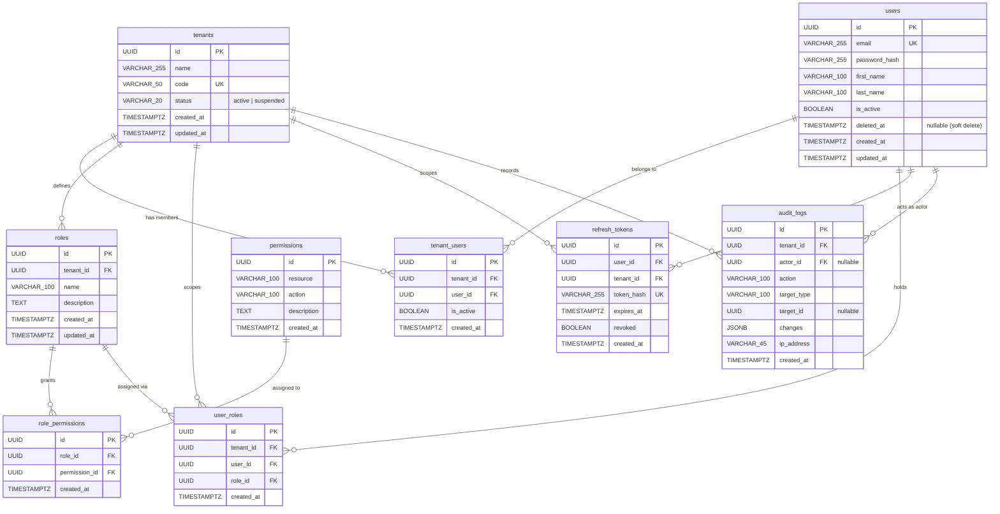

# Entity-Relationship Diagram (ER Diagram)

This document describes the database schema for the **Multi-Tenant User Management System**.
All 9 tables reside in a shared PostgreSQL 16 schema and use `UUID` v4 primary keys (`uuid_generate_v4()`).

---

## 1. Mermaid ER Diagram

---

## 2. Table Relationships & Constraints Summary

| Table | Scope | Unique Constraints | Foreign Keys |
|---|---|---|---|
| `tenants` | Global | `UNIQUE (code)` | — |
| `users` | Global | `UNIQUE (email)` | — |
| `tenant_users` | Tenant ↔ User | `UNIQUE (tenant_id, user_id)` | `tenant_id → tenants(id)`, `user_id → users(id)` |
| `roles` | Tenant-scoped | `UNIQUE (tenant_id, name)` | `tenant_id → tenants(id)` |
| `permissions` | Global | `UNIQUE (resource, action)` | — |
| `role_permissions` | Role ↔ Permission | `UNIQUE (role_id, permission_id)` | `role_id → roles(id)`, `permission_id → permissions(id)` |
| `user_roles` | Tenant-scoped | `UNIQUE (tenant_id, user_id, role_id)` | `tenant_id → tenants(id)`, `user_id → users(id)`, `role_id → roles(id)` |
| `refresh_tokens` | Tenant-scoped | `UNIQUE (token_hash)` | `user_id → users(id)`, `tenant_id → tenants(id)` |
| `audit_logs` | Tenant-scoped | — | `tenant_id → tenants(id)`, `actor_id → users(id) ON DELETE SET NULL` |

---

## 3. Key Indexes

- `idx_tenants_code`, `idx_tenants_status`
- `idx_users_email`, `idx_users_deleted_at` (partial index `WHERE deleted_at IS NULL`), `idx_users_is_active`
- `idx_tenant_users_tenant_id`, `idx_tenant_users_user_id`
- `idx_roles_tenant_id`
- `idx_role_permissions_role_id`, `idx_role_permissions_permission_id`
- `idx_user_roles_tenant_id_user_id`, `idx_user_roles_role_id`
- `idx_refresh_tokens_user_id`, `idx_refresh_tokens_token_hash`, `idx_refresh_tokens_expires_at`
- `idx_audit_logs_tenant_id`, `idx_audit_logs_actor_id`, `idx_audit_logs_tenant_id_created_at`, `idx_audit_logs_target_type`, `idx_audit_logs_action`
